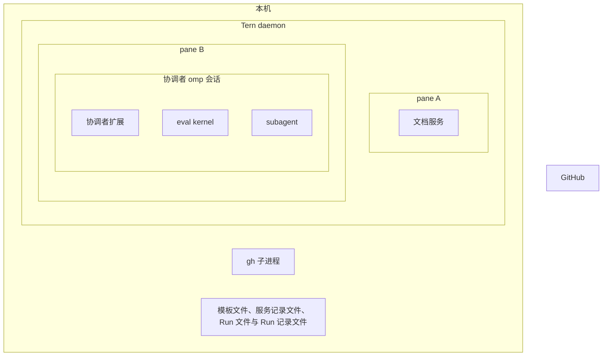
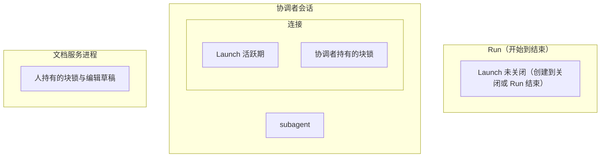
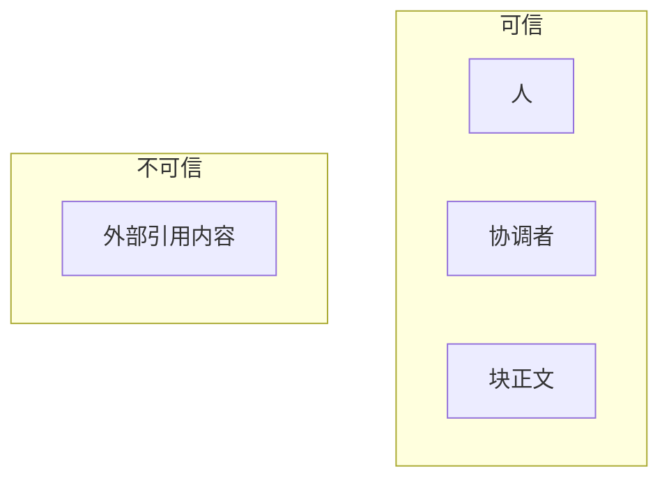
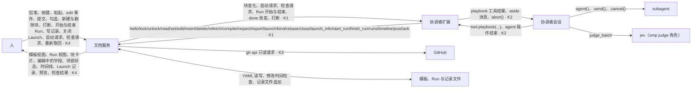

# Tern Playbooks 设计

本文档定义 Tern Playbooks。Tern Playbooks 是一种 agent 工作流系统：人和协调者在 Tern 中编辑同一份 Playbook 文档，文档以表单块显示，块被编译成 prompt，协调者用 omp `eval` 编排 subagent，块被修改后协调者收到通知。人和协调者对同一组操作都有入口：人经表单界面，协调者经 `playbook` 工具。

- 本文档拥有：问题域、驱动、全部术语的定义、系统级范围图、交互图、契约摘要、结构决定。
- [references.md](references.md) 拥有：引用语法、解析器、截取表达式、编译规则、文档取回表与预览。
- [launch-events.md](launch-events.md) 拥有：Launch、基线、块变化事件和启动请求的规则。
- [runs.md](runs.md) 拥有：模板与 Run、Run 的生命周期、时间线与记录的规则。
- [checks.md](checks.md) 拥有：块检查的规则，包括确定性检查与 jev 判定。
- [contracts.md](contracts.md) 拥有：本文档列出的四份契约的完整规格。
- 非目标：
  - 多人协作。参与编辑的只有一个人和一个协调者。
  - 同一块的并发编辑。每个块同一时刻只有一方编辑（S1）。
  - 在文档中显示 subagent 的实时状态。subagent 状态的权威来源是协调者会话，人在协调者的 pane 中查看。
  - 外部来源变化的通知。
  - 文档服务写回文件时与外部程序同时写入的冲突。
  - 由 LLM 计算的截取表达式。
  - 编排块运行期间的热更新。
  - 文档层的约束语言。subagent 输出的 schema、输出检查、条件门控写在编排块的代码中（`agent(…, schema=…)` 等）。
  - Mattermost 中由 bot 定时发出的提醒、Snooze、欢迎消息、复盘提示与待办汇总。它们在 Mattermost 中由不会推理的 bot 按配置发出；这里的 bot 是 agent，这些消息由协调者在需要时自己写（S8）。
- 输入：无。本文档是根节点。
- 读者：实现者与评审者。审批者：项目所有者。

## 问题

### 域

| 域 | 固有性质 | 证据 |
|---|---|---|
| D1 Tern | 1. Tern daemon 托管 pane；窗口关闭后 pane 中的程序继续运行。<br>2. 一个非插件程序可以在自己的 pane 中通过 Tern Surface Protocol（TSP）绘制原生界面。<br>3. `editor` 与 `input` 节点的文本由程序拥有：Tern 只绘制文本、光标和 `decor` 装饰，不修改文本。<br>4. 程序在 `hello` 中声明 `edit` 与 `undo` 特性，并且 Settings › Terminal › Native composer editing 开启（默认开启）时，程序同时收到两种输入：作用于 Tern 选区的编辑和光标移动以 `edit` 事件 `{from, to, text, cursor, len}` 到达，⌘Z 以 `undo` 事件到达；没有选区时的普通输入以按键到达。该设置关闭时，全部输入以按键到达，⌘Z 不到达程序。`edit` 事件不携带帧序号，TSP 不规定输入事件与 `ack` 的先后。插件 block 不声明特性，不收到 `edit` 事件。<br>5. 点击未聚焦的 `input` 或 `editor` 产生 `focus` 事件；带 `actions.click` 的节点被点击时产生 `action` 事件；复选框被点击时产生 `change` 事件。TSP 没有失去焦点事件，点击空白处不产生任何事件。一个节点的 `click` 动作在其后代 `editor` 内被点击时同样触发。<br>6. 插件 API 没有文件变化事件。<br>7. Tern 闭源；只有公开文档和实测行为是可依赖的。<br>8. `md` 节点原生绘制 Markdown，其中的 ` ```mermaid ` 围栏绘制成图；`image` 节点显示经 `b` 动词发送的 blob，SVG 直接绘制，不经栅格化。`hello` 回复的 `dark` 和 `theme` 事件给出当前外观。 | [E1](appendix-evidence.md#e1-tern) |
| D2 omp 协调者会话 | 1. `eval` 提供 `agent()`、`wait()`、`workpool()`，参数包括 `schema=`、`isolated=`；handle 提供 `.send()`、`.cancel()`。<br>2. 扩展注册的工具可以在 `eval` 中以 `tool.<name>(args)` 调用。<br>3. 扩展调用 `sendMessage(…, {deliverAs: "aside", triggerTurn: true})`：会话忙时，消息在下一个步边界注入；会话空闲时，消息开始一个新 turn。<br>4. 协调者会话被销毁时（正常结束，或进程收到 SIGINT、SIGTERM、SIGHUP），它在 `eval` 中用 `agent()` 启动、仍在运行的 subagent 被中止。<br>5. 扩展事件 `before_subagent_spawn` 不含 prompt 或 subagent id。<br>6. omp 的 auto graph（设置 `tui.autoGraph`）在 npm 包 `@oh-my-pi/pi-tui` 中实现，可在 omp 之外导入：`splitTableCharts` 把 Markdown 在数值表格之后切开，`lookupTableChart` 为表格生成按主题着色的 SVG 图，`describeTableChart` 把图转成 TSP `image` 节点。`always` 模式只用本地规则选图；`smart` 模式需要 omp 的判定模型。<br>7. omp 的 `judge` 模型角色在有 TypeSafe 凭据时解析到 jev。`eval` 中的 `judge(state, questions)` 与 `judge_batch(states, questions)` 经这个角色回答类型化问题（bool 给出 P(yes)）。扩展 API 不提供判定接口。<br>8. 扩展的上下文提供 `abort()`，它中止会话当前的 agent 操作，omp 输出 `Interrupted by user`；扩展可以在自己的定时器或 socket 回调中调用它。 | [E2](appendix-evidence.md#e2-omp) |
| D3 GitHub | 1. issue 与 PR 的权威来源是 GitHub。<br>2. 任何能评论的账号都能写入 issue 与 PR 的内容，内容不可信。<br>3. GitHub 不向本机进程推送变化；得知变化只能轮询或接收 webhook。<br>4. `gh` CLI 持有已有的认证。 | [E3](appendix-evidence.md#e3-github) |
| D4 人 | 人修改块的字段，新增、删除块，也会在编辑一个字段的中途离开。 | 需求来源 |
| D5 文件系统 | git checkout 和其他编辑器可以在本系统之外修改 Playbook 文件。 | 需求来源 |

### 共享现象

| 方向 | 现象 |
|---|---|
| 人 → 机器 | 铅笔、按键、粘贴、`edit` 事件、提交（Esc 或完成按钮）、勾选完成、新建与删除块、打断、开始与结束 Run、写记录、关闭 Launch、启动请求、检查请求、重新取回 |
| 机器 → 人 | 模板视图与 Run 视图、块卡片（渲染视图：Markdown、mermaid 图、数值表格的图）、编辑中的字段、块锁状态、依赖块的 Launch 与 agent、时间线与 Launch 记录、引用展开视图、编译预览、检查结果、错误 |
| 协调者 → 机器 | `playbook` 工具调用：加锁、解锁、读、设置字段、编辑正文、新建块、删除块、开始与结束 Run、列出 Run、读时间线、写记录、读 Launch 记录、重新取回、编译、检查、报告检查结果、启动、绑定、改基线、关闭 Launch |
| 机器 → 协调者 | 块变化事件、启动请求事件、检查请求事件、Run 开始与结束事件、`done` 改变事件、打断 |
| 机器 → GitHub | 只读 API 请求 |
| 文件系统 ↔ 机器 | 模板文件、Run 文件与记录文件的读写；外部修改 |

### 使用场景

下列场景来自需求来源（用户），是本设计的验收路径。每一步都写明人的入口与 agent 的入口。

- U1 修复一个 issue。
  1. 人在模板中写块：一个上下文块引用 issue、日志与源码文件，一个计划块，一个实现块与一个评审块（评审块以 `((实现块.result))` 引用实现的结果），一个编排块。
  2. 人在模板视图点"开始 Run"；或者协调者调用 `start_run`。文档服务从模板复制出 Run。
  3. 人在 Run 视图中打开实现块的编译预览，确认 subagent 将收到的 prompt，然后选中编排块点启动。
  4. 协调者收到启动请求，为编排块创建 Launch 并执行编排代码。编排代码对实现块调用 `launch` 再用 `agent()` 启动实现 subagent；实现完成后以 `post` 写入实现块的结果记录，再对评审块调用 `launch` 与 `agent()`。
  5. 进度与结果出现在协调者会话中，也以记录写入 Run 的时间线。
  6. 运行中，人修改计划块并提交。依赖它的 Launch 所属的协调者收到写明差异的通知，自己决定是否告诉 subagent。
  7. agent 修改块或勾选完成时，人在块卡片上看到"协调者正在编辑"；人可以打断。
- U2 复用。上周的 Run 已结束。下周用于另一个 issue：人从模板开始一个新 Run，在新 Run 中只改上下文块中的引用，然后启动；上周的 Run 与它的时间线保持不变。
- U3 回看。人离开后回来，在 Playbook 中看出哪些块被启动过、绑定了哪些 agent、哪些块在启动后被改过、检查结果是什么，不需要翻阅协调者会话。
- U4 事故处理。人启动诊断块；多个 subagent 并行诊断；协调者定期在会话中汇报；人随时调整块并重新启动；结束后对照记录复盘。

### 需求

- R1 人和协调者编辑同一份 Playbook 文档，每个块同一时刻只有一方能编辑：人点击铅笔进入编辑，协调者对块加锁。协调者加锁时拿到该块最新的已提交内容；人编辑中、尚未提交的文本不进入文档。人可以打断协调者对一个块的编辑；打断等同于在 omp 中按 Esc，并解除该块的锁。
- R2 块可以引用另一个块，也可以引用 URL。GitHub issue 或 PR 的引用展开为正文和回复。一个块可以含有任意数量的引用。
- R3 `launch` 返回的快照文本是启动时这组块的编译结果。启动前，人可以看到与之逐字节相等的预览。
- R4 文档服务不向 subagent 提供接口，也不向它发送事件。
- R5 被活跃 Launch 依赖的块正文被人修改，或被本系统之外的程序在磁盘上修改，并且该 Launch 的编译结果因此与最新基线不同或编译失败时，协调者收到一条通知，写明 Launch、绑定的 agent 和差异。是否以及如何告知 subagent，由协调者决定。
- R6 协调者自己的编辑不得产生通知。
- R7 外部来源的变化不得产生通知。
- R8 编排写在文档的编排块中。Launch 的快照保存启动时的编排代码，之后块正文的修改不改变它。
- R9 Playbook 文档在磁盘上是一个 YAML 文件，git 和其他编辑器可以读写。
- R10（由 D3.2 推出）展开的外部内容必须在 prompt 中标出边界。
- R11（由 D4 推出）块 id 不得因编辑而改变。
- R12 块的渲染结果与编译结果在运行时可以被检查：渲染是否出错、内容是否缺失。检查结果显示在块旁。
- R13（由 U2 推出）同一份 Playbook 可以反复使用；每次使用是一个 Run，Run 有开始与结束，修改一个 Run 不改变模板与其他 Run。
- R14（由 U3、U4 推出）一个 Run 中发生的事实（块的修改、勾选、启动、绑定的 agent、发给协调者的事件、打断、被接受的检查报告、人与协调者写的记录）按时间保存，人在界面中、协调者经 `playbook` 工具都能读取，不需要翻阅协调者会话。确定性检查的结果不单独保存，因为它由块正文、取回结果与渲染确认按 [checks.md §4](checks.md#4-触发) 重新计算，块正文的每次修改已在时间线中。

### 驱动

质量场景：

| 编号 | 刺激 | 环境 | 响应 | 度量 |
|---|---|---|---|---|
| Q1 | 人提交对一个被活跃 Launch 依赖的块正文的修改，修改后该 Launch 的编译结果与最新基线不同，也与该 Launch 最近一次被确认的事件所报告的结果（`notified`）不同 | 协调者已连接；该 Launch 没有待确认的块变化事件；提交后 3 s 内没有新的修改；改动没有新增尚未取回的外部目标 | 协调者扩展把一条块变化事件交给协调者会话 | 提交到文档服务收到该事件的 `ack` ≤ 3 s |
| Q2 | 人打开某块的编译预览，然后启动该块 | 文档和外部取回结果在两次操作之间不变 | Launch 快照等于预览 | 逐字节相等 |
| Q3 | 协调者在持有块锁时修改一个被活跃 Launch 依赖的块 | 该 Launch 的 `dirty` 为空；期间没有来源为 `disk` 的编辑 | 无事件 | 0 条 |
| Q4 | 协调者持有一个块的块锁时，人对该块执行打断 | 协调者已连接；发出该锁请求的 agent 操作仍在运行；人没有打开编辑草稿 | 该 agent 操作中止，该块解锁 | 点击到解锁重绘的帧被 `ack` ≤ 1 s；点击到协调者会话的 `agent_end` ≤ 1 s |
| Q5 | 人在一个 2,000 行正文的编辑中字段里按一个键 | 本机 | 字段重绘 | 按键到 TSP 帧发出 ≤ 50 ms |

约束：

| 约束 | 来源 | 排除的方案 |
|---|---|---|
| 编排只用 omp `eval` | 用户决定 | 自建工作流引擎 |
| 只使用 Tern 公开文档中的 API | D1.7 | 依赖 Tern 内部行为 |
| GitHub 只经 `gh` 已有的认证访问 | 凭据规则 | 在本系统中保存 token |
| 参与编辑者为一个人和一个协调者，每个块同一时刻只有一方编辑 | 用户决定 | 网络同步、身份系统、同一块的并发编辑 |
| Playbook 以表单块编辑，持久化为 YAML 文件；文档服务是外部 TSP 程序 | 用户决定 | Markdown 文件加 Tern 自带的 Markdown block；Tern 插件 block |
| 人的编辑只由 Esc 或完成按钮提交，不自动提交 | 用户决定 | 失去焦点或闲置超时自动提交 |

## 架构层

### 定义

- **Playbook 文档**是一种结构化文档，它由标题和有序的块组成，块是 prompt 的来源。它在磁盘上是一个 YAML 文件（S2）。Playbook 文件本身是**模板**；**Run** 是从模板复制出来的一次实例，也是一份 Playbook 文档。规则见 [runs.md](runs.md)。
- **块**是 Playbook 文档中的一个条目，字段为 `id`、`title`、`body`、`done`。`body` 称为**块正文**，是 Markdown 文本；`done` 表示人或协调者把它标为完成。
- **块 id** 是一种标识符，形如 `b<正整数>`。文档服务在块创建时分配块 id：新 id 的数字等于"服务记录中的最大已分配数字"与"文档中的最大数字"两者的较大值加 1。因此文档服务分配的块 id 不复用；磁盘修改新增的块保留文件中的 id，它可以是先前被删除的 id（S2）。
- **编排块**是一种块，它的块正文全部内容是一个 `js` 或 `py` 围栏代码块。
- **引用**是块正文中的一段 `((目标))` 或 `((目标 | 截取表达式))`。规则见 [references.md §1](references.md#1-语法)。
- **编译**是一个过程，它把一组块的块正文中的每个引用替换为该引用的展开文本，得到一个 prompt 文本和一份来源清单。规则见 [references.md §4](references.md#4-编译)。
- **Launch** 是一条记录，它表示协调者在某一时刻编译了一个 Run 中的一组块（1..N 个），并绑定了 0..N 个 agent id。规则见 [launch-events.md §1](launch-events.md#1-launch)。
- **基线**是 Launch 的一个 prompt 文本，它是块变化判定的比较参照，由协调者选定。文档服务不记录 agent 实际依据哪份文本。
- **块变化事件**是文档服务发给协调者的一条通知：一个活跃 Launch 依赖的块被人或磁盘修改后，它的当前编译结果与最新基线不同，或编译失败。规则见 [launch-events.md §3](launch-events.md#3-块变化判定)。
- **启动请求事件**是文档服务发给协调者的一条通知：人要求启动一组块。
- **检查请求事件**是文档服务发给协调者的一条通知：人要求检查一组块。
- **块锁**是文档服务为每个块持有的状态，取值为无、人持有、协调者持有。人持有时只有人的编辑草稿可以提交到该块；协调者持有时只有协调者的修改操作可以改变该块。来源为 `disk` 的编辑不受块锁限制（S2）。规则见 [contracts.md §K1](contracts.md#k1-文档服务--协调者扩展) 与 [§K4](contracts.md#k4-文档服务--tern)。
- **编辑草稿**是人持有块锁时一个字段的未提交文本。编辑草稿不属于 Playbook 文档；提交时它成为一次来源为 `human` 的编辑。
- **打断**是人对协调者持有的块执行的操作：文档服务解除该块的块锁，协调者扩展中止发出该锁请求的 agent 操作（D2.8）。
- **块检查**是对一组块的运行时检查：文档服务计算确定性检查，协调者可以用 jev 判定内容是否缺失。规则见 [checks.md](checks.md)。
- **jev** 是 omp 的 `judge` 模型角色解析到的 TypeSafe 判定模型（D2.7）。
- **渲染视图**是文档服务为一个块的标题与块正文绘制的只读显示。字段不在编辑中时显示渲染视图。规则见 [contracts.md §K4](contracts.md#k4-文档服务--tern)。
- **文档服务**是一个进程，它在内存中持有 Playbook 文档，在一个 Tern pane 中以表单块显示它，并为协调者提供 socket 接口。
- **协调者**是一个加载了协调者扩展的 omp 会话。协调者是文档的一个编辑者，执行编排块，并用 `eval` 的 `agent()` 启动 subagent。
- **协调者扩展**是一个 omp 扩展，它注册 `playbook` 工具，连接文档服务，把事件注入协调者会话，并在打断时中止发出该锁请求的 agent 操作。
- **subagent** 是协调者在 `eval` 中用 `agent()` 启动的 omp 子 agent。
- **连接**是协调者扩展与文档服务之间的一个 socket 会话，它带有协调者会话 id。
- **服务记录文件**是模板文件旁的一个只追加文件 `<文件名>.pb.jsonl`，它保存文档服务分配的块 id、Run id 与 Launch id。
- **时间线**是一个 Run 中按时间追加的事实条目序列，保存在该 Run 的记录文件中，人不编辑它。规则见 [runs.md §3](runs.md#3-时间线)。
- **记录**是人或协调者写入时间线的一段文本，用来报告进度、结果或失败。规则见 [runs.md §4](runs.md#4-记录)。

### 不变量

- I1 一份模板与它的全部 Run 由同一个文档服务进程持有。文档打开期间，文档服务内存中的文档是这些 Playbook 文档的权威来源；磁盘文件是它们的序列化结果。
- I2 Launch 的快照在创建后不改变。基线只能由协调者的 `rebase` 操作改变。
- I3 编译是确定的：对相同的块正文、相同的外部取回结果和相同的块结果，编译输出逐字节相同。因为 R3、Q2。
- I4 agent 状态不写入 Playbook 文档，也不存入文档服务。时间线中的记录是写入者的陈述，文档服务不把它当作 agent 状态维护。
- I5 协调者对已有块的修改只在协调者持有该块的块锁时发生；人对字段文本的修改只在人持有该块的块锁时提交；来源为 `disk` 的编辑不受块锁限制（S2）。

### 结构决定

**S1 文档服务是一个运行在 Tern pane 中的 TSP 程序，把 Playbook 文档显示为表单块：每个块一张卡片，字段默认显示渲染视图；人点击一个字段的铅笔进入编辑，进入编辑即取得该块的块锁。**
因为 R1 要求每个块同一时刻只有一方编辑、协调者拿到最新的已提交内容、人可以打断，约束要求表单块与外部 TSP 程序。D1.3 与 D1.4 说明 TSP 程序拥有 `input` 与 `editor` 的文本并接收编辑。人的输入先进入编辑草稿，提交时才成为文档的一次编辑，所以协调者读到的总是已提交内容，人未提交的输入不会被协调者的修改覆盖，也不需要判断 TSP 输入事件与帧的先后（D1.4）。D1.5 说明 TSP 没有失去焦点事件，所以提交只由 Esc 或完成按钮触发（约束）。D2.8 说明扩展可以中止协调者的当前操作，所以打断可以中止协调者。规则见 [contracts.md §K1](contracts.md#k1-文档服务--协调者扩展) 与 [§K4](contracts.md#k4-文档服务--tern)。
- 替代：Tern 自带的 Markdown 文件 block 加 `cx.docs`。不选，因为它没有文档变化事件，没有只读或锁接口，不能在文档中放操作按钮，块标记的 HTML 注释会显示出来（[E1](appendix-evidence.md#e1-tern) 中"S1 的替代"一行）。
- 替代：整篇文档一个 `editor` 加全文编辑锁。不选，因为 TSP 不规定 `edit` 事件与 `ack` 的先后（D1.4），协调者加锁时无法保证拿到人已输入、仍在途中的输入；用户选择按块的铅笔编辑。
- 替代：Tern 插件 block。不选，因为插件 block 收不到 `edit` 事件（D1.4），并且用户选择外部 TSP 程序。
- 替代：CRDT 支持的同一块并发编辑。不选，因为用户决定不做。
- 重审条件：需求加入同一块的并发编辑，或 TSP 提供失去焦点事件。

**S2 磁盘文件是持久形式，格式为 YAML。**
因为 R9 与约束。文件内容为一个映射 `{title, blocks}`，`blocks` 是块的有序列表，每个块是 `{id, title, body, done}`：`id` 形如 `b<正整数>` 并且在文件中唯一，`title` 与 `body` 是字符串，`done` 是布尔值。
- 文档服务在文档变化后 1 s 内以同目录临时文件加原子替换写回文件，每 1 s 检查一次文件的修改时间。修改时间改变并且内容与上次写回的不同时，文档服务解析文件，按块 id 与上次写回的内容比较；每个块的字段改变、新增、删除与顺序改变，各作为一次来源为 `disk` 的编辑应用。
- 来源为 `disk` 的编辑不受块锁限制。协调者持有的块被修改时，协调者下一次读取时看到修改。人正在编辑的字段被修改时，该字段旁显示"磁盘文件修改了这个字段"，提交时人的编辑草稿覆盖该字段。被锁的块被删除时，块锁解除；人的编辑草稿随之丢弃，并显示"这个块已被磁盘文件删除"。
- 文件不能解析或不符合上面的格式时，文档服务不应用修改，也不写回文件，在界面上显示错误，直到文件再次符合格式。
- 替代：固定结构的 Markdown 文件。不选，因为用户决定使用结构化文件。
- 替代：另存一份编辑历史。不选，因为它会成为第二个权威来源。

**S3 编排只在协调者会话的 `eval` 中运行。**
因为 D2.1 已提供 Dynamic Workflows 所需的原语（约束）。文档服务不启动 agent。
- 替代：用 Tern 的 `cx.agents:start` 启动独立 pane 中的 agent。不选，因为它只接受 prompt、工作目录、命令与位置，没有 `schema`、等待屏障和 DAG 语义（[E1](appendix-evidence.md#e1-tern) 中"S3、S4 的替代"一行），用户已选 `eval`。

**S4 事件通过 `sendMessage` 的 `aside` 投递。**
因为 D2.3：协调者忙时不打断正在执行的工具，空闲时开始新 turn。协调者不需要轮询。
- 替代：Tern 的 `cx.agents:ask`。不选，因为它把文本粘贴进 agent 的输入框并按 Enter，要求输入框就绪（[E1](appendix-evidence.md#e1-tern) 中"S3、S4 的替代"一行）。
- 重审条件：omp 移除 `aside`，或改变它在空闲时的语义。

**S5 文档中不出现 agent 状态（I4）。**
因为 subagent 由协调者会话的 `eval` 创建并持有 handle（D2.1），它的生命周期在协调者会话之内（D2.4），所以 agent 状态的权威来源是协调者会话；D2.5 说明扩展拿不到 subagent 的完整信息，复制一份会产生第二个来源。

**S6 块的渲染视图用 Tern 的 `md` 节点与 omp 的 auto graph 绘制。**
因为 D1.8 与 D2.6：Tern 已原生绘制 Markdown 与 mermaid，omp 已实现数值表格到图的转换并输出 TSP 节点，两者可以直接使用。渲染视图只用于显示，不进入编译结果，所以 I3 不受影响。规则见 [contracts.md §K4](contracts.md#k4-文档服务--tern)。
- auto graph 使用 `always` 模式。不选 `smart`，因为文档服务不连接模型，并且图的选择不需要模型判断。
- 替代：文档服务自己生成图。不选，因为 auto graph 已覆盖柱状、折线、热力图等十一种图形，并跟随主题着色。
- 替代：只显示表格，不出图。不选，因为用户要求与 omp 一致的图形渲染。
- 重审条件：`@oh-my-pi/pi-tui` 不再导出 `chat/table-chart`，或 Tern 的 `md` 节点自己开始为表格出图。

**S7 块检查分两层：确定性检查在文档服务中计算，内容缺失由协调者用 omp 的 jev 判定。**
因为 R12 中"渲染是否出错"可以从文档服务发送的节点与 Tern 回送的 `ack`、`error` 直接判定，而"内容是否缺失"需要语义判断；D2.7 说明 omp 的 jev 只能在协调者会话的 `eval` 中调用，扩展与文档服务都拿不到它。规则见 [checks.md](checks.md)。
- 检查结果与 `launch` 的关系见 [checks.md §4](checks.md#4-触发)。
- 替代：用协调者的主模型做判定。不选，因为 jev 判定 3 个块共花费 $0.000075、耗时 0.5 s（[E2.6](appendix-evidence.md#e26-jev-判定)），主模型的判定会占用协调者的上下文。
- 替代：全部检查交给 jev。不选，因为确定性条件不需要模型，并且 jev 在"图是否对应表格"上答错（E2.6）。
- 重审条件：omp 扩展 API 提供判定接口，此时可以把判定移进协调者扩展。

**S8 Playbook 与协调者会话的分工仿照 Mattermost Playbooks：Playbook 文档对应 run 的 checklist，协调者会话对应 run 的频道，agent（协调者与它启动的 subagent）对应 Playbooks bot。**
因为 Mattermost Playbooks 的核心是 checklist 与频道并排：checklist 上的操作落到频道里，频道里的 bot 推动流程（[E4](appendix-evidence.md#e4-mattermost-playbooks)）。用户决定由 agent 担任 bot。每个操作，人与 agent 都有入口：

| Mattermost 中的交互 | 人的入口（K4） | agent 的入口（K1、K2） | 在协调者会话中出现的内容 |
|---|---|---|---|
| 点任务的 Run，执行任务 | 块卡片的启动按钮 | `launch`，然后在 `eval` 中用 `agent()` 启动 subagent，并以 `bind` 把 agent id 绑定到 Launch | 启动请求事件（[launch-events.md §5](launch-events.md#5-启动请求)） |
| 勾选任务完成；完成与执行是两个操作 | `done` 复选框 | `set {field: "done"}` | 人勾选时为 `done_changed` 事件（[runs.md §2](runs.md#2-生命周期)）；协调者 `set` 时无 |
| 新增、编辑、删除任务 | 新建、铅笔编辑、删除 | `insert`；`lock` 后 `set`、`edit`、`delete` | 无 |
| 任务内容在 run 中被改动 | 提交编辑草稿 | — | 块变化事件（[launch-events.md §4](launch-events.md#4-块变化事件)） |
| 对任务做检查 | 块卡片的检查按钮 | `inspect`、`report` | 检查请求事件（[checks.md §4](checks.md#4-触发)） |
| 从 playbook 开始一次 run | 模板视图的"开始 Run" | `start_run` | 人开始时为 `run_started` 事件（[runs.md §2](runs.md#2-生命周期)）；协调者开始时无 |
| 结束 run | Run 视图的"结束 Run" | `finish_run` | 人结束时为 `run_finished` 事件；协调者结束时无 |
| 发状态更新；把消息加入时间线 | Run 视图中写记录 | `post` | 无；记录写入时间线（[runs.md §4](runs.md#4-记录)） |
| 查看 run 的时间线 | Run 视图的时间线 | `timeline` | 无 |
| 无对应（Mattermost 的任务执行没有持续的依赖通知） | 块卡片 Launch 列表的"关闭" | `close` | 无；`launch_closed` 写入时间线（[launch-events.md §1](launch-events.md#1-launch)） |
| 无对应 | 点时间线中的 `launch_created` 条目 | `launch_info` | 无 |
| 无对应（Mattermost 的任务不引用外部内容） | 块卡片中引用的"重新取回" | `refetch` | 无；依赖它的活跃 Launch 不因此改变（[references.md §5](references.md#5-文档取回表与预览)） |
| 无对应（Mattermost 的 bot 不持有任务的编辑） | 块卡片的打断按钮 | — | 无消息；协调者扩展中止持有该块锁的 agent 操作（[contracts.md §K2](contracts.md#k2-协调者扩展--协调者会话)） |

- 替代：只在协调者会话中用文字驱动全部操作，不提供表单入口。不选，因为用户决定人与 agent 都有操作入口。
- 替代：只提供表单，agent 不参与推动。不选，因为 bot 推动流程是参考对象的核心。

**S9 Playbook 文件是模板，每次使用从模板复制出一个 Run；Launch 属于 Run。**
因为 R13：同一份 Playbook 反复使用时，上一次的块内容、`done` 与 Launch 不得被下一次覆盖或继续触发通知；Mattermost Playbooks 在创建 run 时复制 playbook 的 checklist（[E4](appendix-evidence.md#e4-mattermost-playbooks)）。Run 结束后，它的 Launch 不再活跃，块不再可改。规则见 [runs.md](runs.md)。
- 替代：只有一份文档，复用时人手工改回。不选，因为预演 U2 时旧 Launch 仍活跃，修改模板会向已结束的工作发通知，旧内容也被覆盖。
- 替代：Run 引用模板而不复制。不选，因为修改模板会改变进行中的 Run。

**S10 每个 Run 有一条只追加的时间线，保存文档服务创建或接收的事实与人、协调者写的记录；人与协调者都能读取。**
因为 R14：U3 要求人回来后不翻阅协调者会话也能知道发生了什么；协调者在 `eval` 中等待 subagent 时，注入的消息要到 `eval` 结束后才进入模型（[E2.3](appendix-evidence.md#e23-aside-投递)），编排代码需要一个可以在运行中读取的来源。时间线只记录文档服务自己知道的事实与写入者的陈述，不复制 agent 状态（I4、S5）。规则见 [runs.md §3](runs.md#3-时间线)。
- 替代：只依赖协调者会话的记录。不选，因为会话结束后无法从 Playbook 回看，并且人需要逐条翻阅。
- 替代：由文档服务轮询 omp 取得 agent 状态写入时间线。不选，因为 D2.5 说明扩展拿不到 subagent 的完整信息，并且会产生 agent 状态的第二个来源。

## 范围图

进程/主机包含：



| 部件 | 设计它的节点 | 开始锚点（确认者） | 结束锚点（确认者） |
|---|---|---|---|
| 文档服务 | 本节点 | 文档服务进程在 pane 中启动（Tern daemon） | 进程退出（Tern daemon） |
| 协调者 omp 会话 | 外部（omp） | 会话启动（omp） | `session_shutdown`（omp） |
| 协调者扩展 | 本节点 | 会话加载扩展（omp） | 会话结束（omp） |
| eval kernel、subagent | 外部（omp） | `eval` 首次执行、`agent()` 返回（omp） | 会话结束或 `.cancel()`（omp） |
| gh 子进程 | 外部（gh） | 解析器发起请求（文档服务） | 子进程退出（文档服务） |

生命周期包含：



- 连接同时在文档服务进程的生命周期之内：任一方结束，连接结束。
- 协调者持有的块锁在连接之内，也在发出该锁请求的协调者 agent 操作之内：解锁（包括该操作结束时扩展发出的解锁）、`delete`、打断、该块被磁盘修改删除、所属 Run 结束或连接结束时解除。规则见 [contracts.md §K1](contracts.md#k1-文档服务--协调者扩展) 与 [§K2](contracts.md#k2-协调者扩展--协调者会话)。
- 人持有的块锁开始于人点击铅笔，结束于提交、该块被磁盘修改删除、所属 Run 结束或文档服务进程结束；编辑草稿与它同时开始和结束。规则见 [contracts.md §K4](contracts.md#k4-文档服务--tern)。
- Launch 在所属 Run 之内：Run 结束时文档服务关闭它。Launch 活跃期同时在 Launch 未关闭、所属 Run 进行中与连接存在这三段时间之内（[launch-events.md §2](launch-events.md#2-活跃期)）。Launch 记录在连接结束后保留在 Run 记录文件中；同一协调者会话 id 重新连接时，满足其他条件的 Launch 再次活跃；会话不再回来时，Launch 由人关闭或随 Run 结束关闭。
- Run 的生命周期与协调者会话无关：它由人或协调者开始和结束，跨越多个会话（[runs.md §2](runs.md#2-生命周期)）。

信任包含：



外部引用内容只以加了边界标记的数据形式进入 prompt（[references.md §4](references.md#4-编译)）。

## 交互图



| 契约 | 摘要 |
|---|---|
| K1 文档服务 ⇄ 协调者扩展 | 本地 socket 协议：协调者对块加锁与解锁，读与修改模板与 Run 的块，开始与结束 Run，读时间线与写记录，重新取回外部目标，编译、检查、报告检查结果、创建与结束 Launch、绑定 agent、改基线、确认事件；文档服务推送事件与打断。 |
| K2 协调者扩展 ⇄ 协调者会话 | `playbook` 工具（可在 `eval` 中调用）、`aside` 事件消息、打断时的 `abort()`，以及 agent 操作结束时释放它持有的块锁。 |
| K3 文档服务 → GitHub | 解析器经 `gh api` 只读取回 issue 与 PR。 |
| K4 文档服务 ⇄ Tern | TSP 表单界面：模板视图与 Run 视图、块卡片与渲染视图、铅笔编辑与提交、块锁状态与打断、时间线、记录与 Launch 记录、预览、检查结果，以及新建、删除、勾选、开始与结束 Run、关闭 Launch、启动、检查与重新取回操作。 |

完整规格见 [contracts.md](contracts.md)。subagent 与协调者之间的交互属于 omp（D2.1），本设计不规定。

## 主题文件

| 文件 | 拥有的规则 |
|---|---|
| [references.md](references.md) | 引用语法、目标种类与解析器、截取表达式、编译与错误、文档取回表与预览 |
| [launch-events.md](launch-events.md) | Launch 与基线、活跃期、块变化判定、事件内容与投递时机 |
| [runs.md](runs.md) | 模板与 Run、Run 的生命周期、时间线、记录与读取 |
| [checks.md](checks.md) | 检查状态、确定性检查、jev 判定的问题与阈值、检查的触发、结果显示 |
| [contracts.md](contracts.md) | K1–K4 的完整规格 |

## 附录

| 附录 | 内容 |
|---|---|
| [appendix-evidence.md](appendix-evidence.md) | D1–D3 的证据：Tern 文档摘录与 TSP 实测（编辑输入、表单块的点击与焦点事件、渲染视图与 auto graph 截图、Tern 自带 Markdown block 的能力）、omp 源码位置与扩展探针记录（eval 工具桥、aside 投递、`abort()` 打断与界面打断、subagent 随会话结束）、jev 判定实测、`gh api` 实测；S8 与 S9 所参照的 Mattermost Playbooks 的界面观察与源码摘录 |
